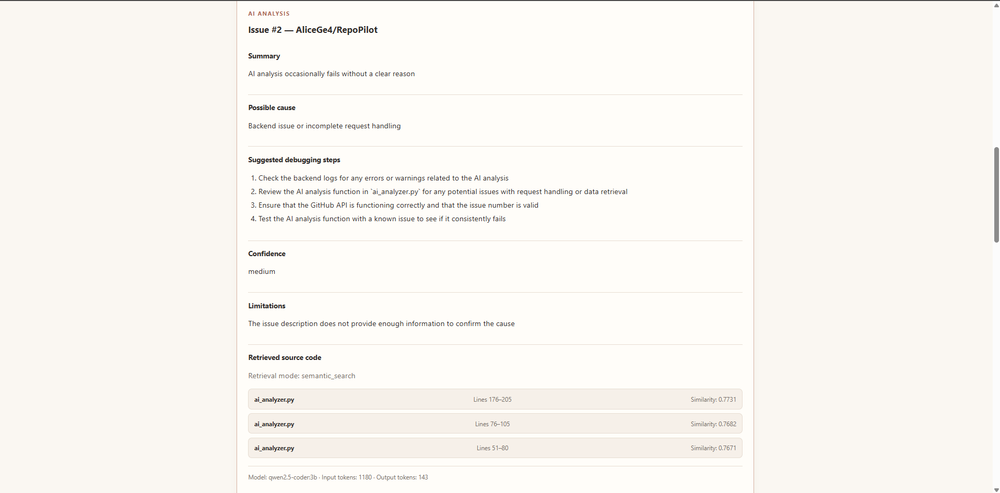

# RepoPilot — AI-Powered GitHub Issue Analyzer

RepoPilot is a full-stack developer tool that uses locally hosted AI and retrieval-augmented generation (RAG) to analyze GitHub issues and identify potentially relevant source code.

The application helps developers investigate bugs by retrieving GitHub issues, searching repository code using semantic similarity, and generating structured debugging suggestions.

**RepoPilot runs its AI models locally through Ollama, without requiring a paid AI API.**

## Key Features

### GitHub Integration
- Retrieve repository information and GitHub issues.
- Browse open issues and select individual issues for analysis.
- Discover and retrieve repository source files.
- Filter source files by extension.

### AI-Powered Issue Analysis
- Analyze GitHub issues using Qwen2.5-Coder 3B.
- Generate issue summaries, possible causes, and debugging suggestions.
- Return structured JSON responses with confidence levels and limitations.
- Support three analysis modes:
  - **Automatic (RAG):** Retrieve relevant source code automatically.
  - **Manual:** Select specific source files for analysis.
  - **Issue-only:** Analyze an issue without source code.

### Retrieval-Augmented Generation (RAG)
- Retrieve source code from GitHub repositories.
- Split source code into overlapping chunks.
- Generate vector embeddings using `nomic-embed-text`.
- Store embeddings in a local JSON index.
- Perform semantic code searches using cosine similarity.
- Return matching source code with filenames, line numbers, and similarity scores.
- Automatically supply retrieved code to the AI analyzer.

### React Frontend
- Interactive dashboard built with React and TypeScript.
- GitHub repository selection and issue browsing.
- Repository indexing and semantic search controls.
- AI analysis results with debugging recommendations and source references.
- Responsive layout for desktop and mobile.
- **Light/Dark Mode toggle**, featuring a warm light theme and the original dark-blue theme.
- Theme preferences saved in browser local storage.

## Technology Stack

| Category | Technologies |
|---|---|
| Backend | Python, FastAPI, Pydantic |
| Frontend | React, TypeScript, Vite, CSS |
| AI | Ollama, Qwen2.5-Coder 3B |
| Embeddings | nomic-embed-text |
| Retrieval | RAG, Vector Embeddings, Cosine Similarity |
| APIs | GitHub REST API, HTTPX |
| Storage | Local JSON Vector Index |
| Development | Git, GitHub, npm, Uvicorn |

## Project Architecture

The application uses the following workflow:

1. The user selects a GitHub repository and issue in the React frontend.
2. The frontend sends an HTTP request to the FastAPI backend.
3. The backend retrieves the issue description from GitHub.
4. The semantic search engine retrieves relevant code chunks from the local vector index.
5. The retrieved code and issue description are provided to Qwen2.5-Coder through Ollama.
6. The AI generates a structured analysis.
7. FastAPI returns the results to the React dashboard.

The backend and local AI models operate separately from the frontend.

## Installation

### Prerequisites

- Python 3.11 or newer
- Node.js and npm
- Git
- Ollama

### 1. Clone the repository

`git clone https://github.com/AliceGe4/RepoPilot.git`

`cd RepoPilot`

### 2. Set up the Python backend

Create a virtual environment:

`python -m venv .venv`

Activate it on Windows PowerShell:

`.\.venv\Scripts\Activate.ps1`

Install dependencies:

`python -m pip install -r requirements.txt`

### 3. Install the local AI models

Install Ollama from https://ollama.com/download.

Download the models:

`ollama pull qwen2.5-coder:3b`

`ollama pull nomic-embed-text`

Ensure Ollama is running before performing AI analysis or semantic search.

### 4. Configure environment variables

Create a `.env` file in the RepoPilot root directory.

Add the following settings:

`GITHUB_TOKEN=`

`OLLAMA_MODEL=qwen2.5-coder:3b`

`EMBEDDING_MODEL=nomic-embed-text`

A GitHub token is optional for public repositories, subject to GitHub API rate limits.

Never commit real API tokens or private environment files.

### 5. Start the backend

From the RepoPilot root directory:

`python -m uvicorn main:app --reload`

The backend runs at:

http://127.0.0.1:8000

Interactive API documentation:

http://127.0.0.1:8000/docs

### 6. Start the frontend

Open a second terminal and navigate to the frontend folder:

`cd frontend`

Install the frontend dependencies:

`npm install`

Start the development server:

`npm run dev`

Open the application at:

http://localhost:5173

Both FastAPI and Ollama must be available for AI analysis.

## How to Use RepoPilot

1. Open the React dashboard.
2. Enter the GitHub repository owner and name.
3. Click **Load GitHub issues**.
4. Select an issue or enter its number manually.
5. Click **Build / Rebuild Index** to prepare the repository for semantic search.
6. Select **Automatic (RAG)**, **Manual**, or **Issue description only**.
7. Click **Analyze with AI**.
8. Review the summary, possible cause, suggested debugging steps, and retrieved source-code references.

The semantic search section also supports direct natural-language searches against an indexed repository.

## API Endpoints

| Method | Endpoint | Description |
|---|---|---|
| GET | `/api/repos/{owner}/{repo}` | Retrieve repository information |
| GET | `/api/repos/{owner}/{repo}/issues` | Retrieve and filter issues |
| GET | `/api/repos/{owner}/{repo}/issues/{number}` | Retrieve an individual issue |
| GET | `/api/repos/{owner}/{repo}/files` | List repository source files |
| GET | `/api/repos/{owner}/{repo}/files/content` | Read source-file contents |
| POST | `/api/repos/{owner}/{repo}/index` | Generate a repository vector index |
| GET | `/api/repos/{owner}/{repo}/search` | Perform semantic code search |
| POST | `/api/repos/{owner}/{repo}/analyze` | Analyze a GitHub issue using AI |

## Example AI Analysis

Send a POST request to:

`/api/repos/AliceGe4/RepoPilot/analyze`

Example JSON request:

`{"issue_number": 1, "file_paths": [], "auto_retrieve": true, "top_k": 3}`

The application retrieves Issue #1, searches the indexed repository for relevant code, and sends the results to the local AI model.

The response includes an analysis, debugging suggestions, confidence, limitations, and retrieval metadata.

## Development Progress

- [x] **Stage 1:** GitHub REST API integration.
- [x] **Stage 2:** Local AI-powered issue analysis.
- [x] **Stage 3A:** Repository indexing and semantic code search.
- [x] **Stage 3B:** Automatic RAG integration with the AI analyzer.
- [x] **Stage 4:** React and TypeScript frontend with theme switching.
- [ ] **Stage 5:** Automated testing, AI evaluation, reliability improvements, and deployment planning.

## Current Limitations

- Local AI inference requires Ollama to be running.
- Only public or otherwise accessible GitHub repositories are supported by the configured API permissions.
- Repository indexing currently has file-size, file-count, and chunk-count limits.
- Repository indexes must be rebuilt when source code changes.
- AI analysis may produce incorrect or incomplete diagnoses.
- Confidence levels are model-generated estimates, not calibrated accuracy probabilities.
- The application currently runs locally and is not publicly deployed.
- Automated evaluation and production security controls are not yet complete.

## Future Improvements

- Automated unit and integration tests.
- Retrieval-accuracy evaluation using known bugs.
- Improved function-aware code chunking.
- Better error handling and loading feedback.
- Persistent vector database integration.
- Frontend component refactoring.
- Deployment and infrastructure improvements.

## Project Status

**Stage 4 implemented. Stage 5 — Testing, Evaluation, and Deployment — is next.**

RepoPilot is an ongoing portfolio project focused on full-stack development, AI integration, semantic search, and practical software engineering.